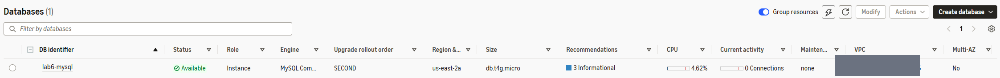

# Étape 04 — Comprendre et déployer RDS MySQL

[English](en/04-rds.md) | [Accueil](../README.fr.md)

## Deux parties pour comprendre et vérifier

- **04A, maintenant :** créer l'instance RDS privée, le schéma vide `labapp`, le groupe de sous-réseaux, les paramètres TLS et le secret administrateur.
- **04B, après validation de 04A :** automatiser l'initialisation SQL, les tables et le compte applicatif aux droits limités, puis tester une connexion SQL vérifiée par TLS.

Ce guide couvre **04A**. La suite est décrite dans [04B : initialisation SQL automatisée](04b-sql-bootstrap.md). L'étape 04 complète ne sera validée qu'après 04B. Aucun compte applicatif ni aucune table métier n'est créé par le template 04-rds.yaml.

## 1. Ce qui change par rapport au premier lab

Dans le premier lab, MariaDB tournait sur une EC2 que tu administrais. Ici, **MySQL tourne dans RDS** : AWS gère notamment l'infrastructure du service, les mécanismes de sauvegarde et la maintenance prévue. Tu définis le moteur, la taille, le réseau, les comptes SQL et la conservation des données.

Tes EC2 restent les serveurs de l'application. Elles enverront des requêtes SQL à RDS sur TCP 3306. Le bastion permettra l'initialisation et le dépannage. RDS n'est pas un serveur à administrer par SSH.

Deux contrôles se complètent :
1. le **groupe de sécurité** autorise le trafic réseau depuis le groupe web ou bastion ;
2. **MySQL** authentifie le compte et vérifie ses droits SQL.

Une ouverture réseau ne donne donc pas automatiquement accès aux tables.

## 2. Lire le template avant de le lancer

Ouvrir `cloudformation/04-rds.yaml`. Il déclare trois ressources CloudFormation :

| Ressource | Rôle concret |
|---|---|
| `DbSubnetGroup` | Référence les deux sous-réseaux privés déjà créés ; indique où RDS peut être placé |
| `DbParameterGroup` | Configure MySQL 8.4 pour exiger des connexions chiffrées |
| `Database` | Crée l'instance RDS, son stockage et le schéma vide `labapp` |

RDS crée également le secret administrateur dans Secrets Manager grâce à `ManageMasterUserPassword`. Ce secret est géré par RDS, pas déclaré comme une quatrième ressource du template.

| Propriété | Valeur du lab | Pourquoi |
|---|---|---|
| `Engine` / `EngineVersion` | MySQL / version 8.4 vérifiée dans Ohio | Utiliser le moteur du guide avec une version réellement disponible |
| `DBInstanceClass` | `db.t4g.micro` | Petite capacité pour ce lab temporaire |
| `DBName` | `labapp` | Créer le schéma initial ; les tables seront ajoutées en 04B |
| `DBSubnetGroupName` | Groupe des deux sous-réseaux privés | Définir les emplacements réseau éligibles |
| `AvailabilityZone` / `MultiAZ` | AZ A / `false` | Une seule instance de base, sans standby Multi-AZ |
| `PubliclyAccessible` | `false` | Connectivité privée dans le VPC |
| `VPCSecurityGroups` | Groupe RDS de l'étape 02 | Autoriser le port 3306 depuis les groupes web et bastion |
| `AllocatedStorage` / `StorageType` | 20 Gio / gp3 | Capacité SSD allouée à la base |
| `StorageEncrypted` | `true` | Chiffrer les données stockées |
| `require_secure_transport` | `1` | Exiger le chiffrement des connexions SQL |
| `MasterUsername` | `admin` | Compte d'administration pour l'initialisation |
| `ManageMasterUserPassword` | `true` | RDS génère le mot de passe et le conserve dans Secrets Manager |
| `BackupRetentionPeriod` | 1 jour | Courte rétention des sauvegardes automatiques |
| `AutoMinorVersionUpgrade` | `true` | Autoriser les mises à jour mineures automatiques prévues par RDS |
| `DeletionPolicy` / `UpdateReplacePolicy` | `Delete` | Supprimer les données temporaires lors de la suppression/remplacement |

**Deux sous-réseaux dans deux AZ ne signifient pas deux bases.** Le DB subnet group fournit les emplacements éligibles ; `MultiAZ: false` crée une seule instance, placée ici en AZ A. RDS demande normalement une couverture de deux AZ dans ce groupe même pour Single-AZ.

Le chiffrement du stockage et TLS protègent deux choses différentes : les données au repos et les données en transit. Les clients de 04B vérifieront également le certificat et le nom du serveur.

## Comprendre la structure du code CloudFormation

- **`Parameters`** : les valeurs nécessaires au déploiement. Le script les remplit avec les sorties réseau/sécurité et les options RDS disponibles ; aucun ID n'est à recopier.
- **`Resources`** : l'état des trois ressources AWS à créer et à gérer dans cette stack.
- **`Outputs`** : les informations générées que l'étape suivante réutilisera, comme l'endpoint.
- **`!Ref DbSubnetGroup`** : réutilise le nom du groupe de sous-réseaux créé dans ce template. Cette référence exprime aussi une dépendance de création.
- **`!GetAtt Database.Endpoint.Address`** : lit l'adresse DNS fournie par AWS pour l'instance RDS.

L'**instance RDS** est le serveur MySQL géré. **`labapp`** est une base logique à l'intérieur. Les **tables** de cette base seront créées en 04B. Ce sont trois niveaux différents.

Le script Bash prépare les entrées, appelle CloudFormation et lit les résultats. CloudFormation provisionne les ressources ; le script actuel n'exécute aucune commande SQL.

## 3. Mot de passe, endpoint et responsabilités

Le mot de passe administrateur est généré par RDS. Le script n'affiche et ne récupère pas sa valeur. La sortie **`MasterSecretArn` identifie le secret** ; les droits IAM contrôleront sa lecture lors de l'initialisation automatisée.

Le futur compte applicatif recevra uniquement les droits SQL requis. L'application utilisera ce compte. Le compte `admin` reste destiné à l'administration.

La sortie **`DbEndpoint` est un nom DNS de serveur MySQL**. Le client SQL utilisera ce nom et le port 3306 ; il ne s'agit pas d'une URL HTTP. Le NAT n'est pas utilisé pour les connexions privées EC2 → RDS dans le VPC.

## 4. Branche et déploiement

Après fusion de l'étape 03 :

```bash
git switch develop
git pull --ff-only origin develop
git switch -c infra/04-rds
```

Extraire le correctif à la racine du dépôt en conservant les chemins. Examiner les ajouts personnels avant de remplacer les README.

```bash
bash scripts/deploy-rds.sh
```

Le script :
1. vérifie les stacks `lab6-network` et `lab6-security`, leur VPC commun et les deux AZ privées ;
2. demande à AWS les options MySQL 8.4 disponibles pour la classe, AZ A, gp3, le chiffrement et 20 Gio ;
3. choisit la version compatible la plus récente lors de la première création, en triant correctement les numéros de version ;
4. conserve la version et la classe demandées par la stack lors des relances, sauf modification explicite ;
5. valide et déploie `lab6-rds`, affiche la configuration puis vérifie la valeur du paramètre TLS ;
6. garde les sorties dans `local/rds-outputs.json`, ignoré par Git.

Les vérifications d'options ne garantissent pas les quotas, permissions ou crédits de ton compte. Si AWS ne propose pas la classe demandée, le script s'arrête. Après examen, une alternative micro peut être demandée explicitement :

```bash
LAB_DB_CLASS=db.t3.micro bash scripts/deploy-rds.sh
```

Pour demander une version précise, `LAB_MYSQL_VERSION` est disponible ; elle doit passer les mêmes vérifications de compatibilité. Ne pas la changer sur une base existante sans examiner l'impact. Les mises à jour mineures automatiques RDS peuvent aussi faire évoluer la version effective pendant la durée de vie du service.

La création RDS peut prendre plusieurs minutes. Laisser le déploiement terminer.

## 5. Lire et vérifier le résultat

Attendu :
- stack **`CREATE_COMPLETE`**, instance **`available`** ;
- moteur MySQL 8.4, classe micro, schéma `labapp` ;
- `Public: False`, `MultiAZ: False`, `Encrypted: True`, stockage 20 Gio gp3 ;
- même VPC que les autres ressources et AZ A ;
- port 3306, endpoint présent, secret administrateur `active` ;
- `require_secure_transport=1`.

Le secret et RDS/stockage sont facturables, en plus des ressources déjà déployées. La gratuité n'est pas déduite du type de compte. Les instances micro RDS peuvent également facturer des crédits CPU supplémentaires selon leur utilisation.

Pour vérifier les trois ressources CloudFormation :

```bash
aws cloudformation list-stack-resources \
  --stack-name lab6-rds \
  --query 'StackResourceSummaries[].[LogicalResourceId,ResourceType,ResourceStatus]' \
  --output table --region us-east-2 --no-cli-pager
```

Un statut `available` ne prouve pas une connexion SQL depuis le bastion ou l'application : ce sera testé en 04B.

En cas d'échec :

```bash
aws cloudformation describe-stack-events \
  --stack-name lab6-rds \
  --query 'StackEvents[?ResourceStatus==`CREATE_FAILED` || ResourceStatus==`UPDATE_FAILED`].[LogicalResourceId,ResourceStatusReason]' \
  --output table --region us-east-2 --no-cli-pager
```

Lire la cause exacte avant de relancer. Une stack `ROLLBACK_COMPLETE` doit être examinée puis supprimée avant une nouvelle création. Ne pas supprimer une base contenant des données que tu souhaites garder.

## Résultat observé de 04A

Le 6 novembre 2026, AWS CLI a confirmé : instance `available`, MySQL `8.4.13`, base `labapp`, port 3306, stockage chiffré, accès public désactivé et Single-AZ. Les tests SQL restent à effectuer en 04B.



*Instance MySQL lab6-mysql disponible dans us-east-2a. La colonne Multi-AZ indique No.*

## 6. Git et suite de l'étape

Nous restons sur `infra/04-rds` pour 04A et 04B. Après validation de cette première partie, un commit intermédiaire est possible :

```bash
git add README.md README.fr.md cloudformation/04-rds.yaml scripts/deploy-rds.sh docs/04-rds.md docs/en/04-rds.md
git diff --cached --check
git diff --cached --stat
git commit -m "infra: add private RDS MySQL with managed admin secret"
git push -u origin infra/04-rds
```

Noter les résultats réellement obtenus dans les README et le guide. Conserver l'étape 04 « en cours » jusqu'à l'initialisation SQL et aux tests. La PR complète vers `develop` pourra alors réunir toute l'étape.

## 7. Suppression à la fin du lab

Ce lab choisit une suppression complète des données temporaires : `DeletionProtection: false`, `DeletionPolicy: Delete`, `UpdateReplacePolicy: Delete` et `DeleteAutomatedBackups: true`. La suppression ne génère pas de snapshot final et retire les sauvegardes automatiques. RDS supprime également son secret administrateur géré. Les snapshots manuels/copies créés séparément doivent être vérifiés à part.

Après suppression des futures ressources qui dépendent de cette base :

```bash
aws cloudformation delete-stack --stack-name lab6-rds --region us-east-2
aws cloudformation wait stack-delete-complete --stack-name lab6-rds --region us-east-2
```

Ces commandes sont destinées au nettoyage final, pas au déploiement. Le reste du lab, dont EC2 et le NAT, continue d'exister jusqu'à suppression de ses stacks.

## Sources

- [CloudFormation — DBInstance](https://docs.aws.amazon.com/AWSCloudFormation/latest/TemplateReference/aws-resource-rds-dbinstance.html)
- [AWS — RDS dans un VPC](https://docs.aws.amazon.com/AmazonRDS/latest/UserGuide/USER_VPC.WorkingWithRDSInstanceinaVPC.html)
- [AWS — mot de passe administrateur géré par RDS](https://docs.aws.amazon.com/AmazonRDS/latest/UserGuide/rds-secrets-manager.html)
- [AWS — TLS obligatoire sur MySQL](https://docs.aws.amazon.com/AmazonRDS/latest/UserGuide/mysql-ssl-connections.require-ssl.html)
- [AWS — options RDS disponibles](https://docs.aws.amazon.com/cli/latest/reference/rds/describe-orderable-db-instance-options.html)
- [Tarification RDS MySQL](https://aws.amazon.com/rds/mysql/pricing/)
