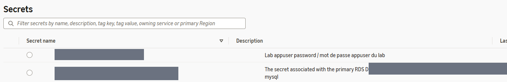

# Étape 04B — Initialisation SQL automatisée avec CloudFormation et SSM

[English](en/04b-sql-bootstrap.md) | [RDS 04A](04-rds.md) | [Accueil](../README.fr.md)

## Ce que nous ajoutons

RDS est maintenant disponible. Cette étape crée les tables et le compte applicatif, puis teste les accès **depuis les vrais serveurs privés**. Toutes les ressources AWS ajoutées, ainsi que les documents et associations d'exécution, sont gérées par CloudFormation.

Le script local orchestre les déploiements depuis Git Bash. Les commandes SQL s'exécutent sur les EC2 via Systems Manager, sans saisir de mot de passe et sans copier de clé SSH.

## 1. Trois contrôles différents à comprendre

| Contrôle | Question traitée | Notre configuration |
|---|---|---|
| Groupe de sécurité | Cette machine peut-elle joindre RDS sur TCP 3306 ? | Groupes web et bastion autorisés |
| IAM | Cette EC2 peut-elle lire ce secret dans AWS ? | Bastion : secrets admin et app ; web : secret app uniquement |
| MySQL | Ce compte peut-il effectuer cette opération SQL ? | `appuser` : SELECT, INSERT, UPDATE, DELETE sur `labapp.*` |

**Le rôle IAM et le compte MySQL sont deux identités distinctes.** Le rôle permet de récupérer un mot de passe depuis AWS ; ce mot de passe authentifie ensuite le compte SQL auprès de MySQL.

La politique de confiance du rôle autorise EC2 à l'assumer. La politique de permissions définit les secrets lisibles. Un **instance profile** associe ce rôle à l'instance EC2. Aucune clé d'accès IAM persistante n'est créée.

## 2. Ressources de la nouvelle stack

`cloudformation/04b-sql-bootstrap.yaml` crée la stack **`lab6-sql-bootstrap`** :

- un secret applicatif : utilisateur `appuser`, mot de passe généré de 32 caractères ;
- un rôle et un profil pour le bastion, puis un rôle et un profil pour les serveurs web ;
- un document SSM contenant l'installation du client Python et le programme SQL ;
- trois associations SSM activées seulement lorsque les profils et agents sont prêts.

Une **association SSM** relie un document d'exécution à une instance cible. `WaitForSuccessTimeoutSeconds` demande à CloudFormation d'attendre le résultat. Les deux tests web dépendent de la réussite de l'initialisation sur le bastion.

L'agent SSM est présent sur l'AMI Amazon Linux 2023 utilisée. Il contacte les services AWS en sortie ; aucun nouveau port entrant n'est ajouté pour SSM. Les EC2 privées utilisent le NAT pour SSM, Secrets Manager et les téléchargements. Leur connexion SQL à RDS reste privée, via les routes locales du VPC.



*Secrets Manager affiche deux entrées distinctes pour appuser et le compte administrateur géré par RDS.*

## 3. Pourquoi le template EC2 évolue aussi

Les trois EC2 reçoivent un profil IAM via une mise à jour de `lab6-ec2`. Le paramètre de l'AMI devient un ID figé : le script réutilise **l'AMI déjà déployée**, afin que la dernière AMI publique ne soit pas résolue involontairement pendant cette mise à jour.

Le nom de ta clé du premier lab est conservé avec `UsePreviousValue`. Le script examine un change set et **refuse tout remplacement d'EC2 annoncé, même conditionnel**. Les groupes, sous-réseaux, disques et paramètres SSH gardent les valeurs de la stack existante. Les profils IAM s'attachent en place.

Le script `deploy-ec2.sh` est mis à jour pour conserver aussi l'AMI et les profils lors de ses futures relances. Sur une première création, il récupère encore l'AMI Amazon Linux 2023 depuis le paramètre public AWS.

## 4. Ce que fait le SQL sur le bastion

Ouvrir le bloc `SqlDocument → Content → mainSteps` du template 04B. Le programme Python intégré :

1. récupère les secrets en mémoire, via le rôle IAM du bastion ;
2. ouvre une connexion TLS vers le nom DNS RDS, avec vérification du certificat et du nom de serveur ;
3. crée `courses`, `students`, `enrollments` et la vue `v_course_stats` ;
4. charge des données de démonstration fictives : 8 cours et 12 apprenants ;
5. crée les deux identités MySQL `appuser@hôte` correspondant aux réseaux web ;
6. applique uniquement les quatre droits nécessaires et vérifie les comptes ;
7. vérifie qu'une connexion `appuser` depuis le bastion est refusée.

Le schéma correspond aux champs requis par l'application du lab de référence. Les données sont fictives et propres à cette adaptation. `CREATE TABLE IF NOT EXISTS` et `INSERT IGNORE` rendent une relance compatible avec les tables et données déjà présentes. Les tables ne sont pas supprimées pour recharger le jeu de démonstration.

Les hôtes MySQL sont :

- `10.10.11.0/255.255.255.0` ;
- `10.10.12.0/255.255.255.0`.

Ce sont les deux réseaux privés web en notation réseau/masque. Dans MySQL, l'identité comprend **l'utilisateur et l'hôte** : un même nom `appuser` peut donc avoir deux entrées, avec les mêmes permissions et le même secret. Le bastion appartient à `10.10.0.0/28`, en dehors de ces réseaux.

`REQUIRE SSL` est appliqué aux comptes. Le paramètre serveur de 04A exige déjà TLS ; le client vérifie aussi l'identité du serveur. Les mots de passe ne sont pas imprimés, passés en arguments de commande ni écrits dans les fichiers du dépôt.

## 5. Ce que les deux serveurs web vérifient

Le même document SSM, en mode test, s'exécute séparément sur web A et web B :

- lecture du secret applicatif autorisée ;
- lecture du secret administrateur refusée par IAM ;
- connexion MySQL avec `appuser`, TLS et vérification du serveur ;
- identification du compte effectivement utilisé avec `CURRENT_USER()` ;
- lecture, ajout, modification et suppression d'une ligne de test ;
- `ROLLBACK` final pour ne pas conserver cette ligne ;
- lecture de la table système `mysql.user` refusée par MySQL.

Les compteurs `AUTO_INCREMENT` peuvent avancer même après un rollback : les numéros peuvent présenter des trous sans perte de données. Le test utilise une adresse fictive unique pour chaque ligne temporaire.

## 6. Exécuter depuis ta branche actuelle

Rester sur **`infra/04-rds`**. Extraire les fichiers du correctif à la racine du dépôt en conservant les chemins ; relire les modifications personnelles avant de remplacer les README.

```bash
git branch --show-current
git status
bash scripts/deploy-sql-bootstrap.sh
```

Le script procède dans cet ordre :

1. vérifie les stacks prérequises, RDS disponible, NAT activé, EC2 en cours d'exécution et AMI cohérente ;
2. déploie la stack SQL avec `RunSqlBootstrap=false` : secret, rôles, profils et document, sans exécution SQL ;
3. attache les profils par un change set EC2 contrôlé, avec AMI et clé conservées ;
4. attend que les trois agents SSM soient `Online` ;
5. met la stack SQL à jour avec `RunSqlBootstrap=true` ;
6. affiche les trois résultats.

`CAPABILITY_IAM` dans le script reconnaît explicitement que cette stack crée des rôles IAM. Les permissions du compte qui lance CloudFormation doivent autoriser ces opérations et le passage des rôles aux EC2.

Une relance désactive puis recrée les associations pour réexécuter le document courant ; elle conserve le secret applicatif existant. L'installation utilise PyMySQL 1.2.3 dans un environnement virtuel sur chaque instance.

La propagation des rôles et l'enregistrement SSM peuvent prendre quelques minutes. Les agents sont attendus au maximum dix minutes par instance. Le nouveau secret applicatif ajoute des frais Secrets Manager ; les trois EC2, RDS et le NAT restent déployés.

## 7. Lire les preuves de réussite

Le déploiement final doit terminer avec `UPDATE_COMPLETE` sur `lab6-sql-bootstrap`. Chaque invocation SSM doit afficher **`Status: Success`**.

| Résultat | Signification |
|---|---|
| `SQL_INIT_OK` | Initialisation administrateur réussie avec TLS |
| `app_login_from_bastion=denied` | Le compte applicatif est limité aux réseaux web |
| Deux résultats `SQL_APP_OK` | Accès applicatif validé depuis chaque EC2 privée |
| `SELECT_INSERT_UPDATE_DELETE=ok` | Les quatre opérations ont réellement fonctionné |
| `admin_table=denied` | Les tables d'administration MySQL restent interdites |
| `master_secret=denied` | Le rôle web ne peut pas lire le secret administrateur |
| `tls=...` | Un chiffrement TLS a été négocié avec vérification côté client |

Pour relire les résultats sans relancer l'initialisation :

```bash
bash scripts/show-sql-results.sh
```

Les journaux de paquets restent sur les instances dans `/var/log/lab6-sql-packages.log`. Une erreur SQL affiche une étape et un code numérique, sans reproduire le message brut susceptible de contenir des informations sensibles.

En cas d'échec de stack :

```bash
aws cloudformation describe-stack-events \
  --stack-name lab6-sql-bootstrap \
  --query 'StackEvents[?ResourceStatus==`CREATE_FAILED` || ResourceStatus==`UPDATE_FAILED`].[LogicalResourceId,ResourceStatusReason]' \
  --output table --region us-east-2 --no-cli-pager
```

Si un agent reste hors ligne, vérifier le profil IAM, l'agent et sa sortie réseau avant de réessayer. Si une exécution a échoué, lire son résultat SSM. Si les sorties de commande ne sont pas encore disponibles après le déploiement, patienter quelques secondes puis relancer uniquement le script de lecture.

**CloudFormation pilote les commandes, mais ne suit pas chaque table ou ligne comme une ressource distincte.** Un rollback de stack ne défait pas les instructions SQL déjà exécutées. L'initialisation est conçue pour être relancée après correction ; les changements de comptes et de schéma ne forment pas une transaction globale annulable.

## 8. Commit et PR après les validations réelles

```bash
git add README.md README.fr.md cloudformation/03-ec2.yaml cloudformation/04-rds.yaml cloudformation/04b-sql-bootstrap.yaml scripts/deploy-ec2.sh scripts/deploy-rds.sh scripts/deploy-sql-bootstrap.sh scripts/show-sql-results.sh docs/
git diff --cached --check
git diff --cached --stat
git commit -m "infra: provision private RDS and bootstrap restricted SQL accounts"
git push -u origin infra/04-rds
```

Avant le commit final, consigner les résultats réellement obtenus dans les deux README et les guides. La PR vers `develop` couvre 04A et 04B, y compris l'ajout des profils au template EC2. L'étape 05 installera ensuite Flask et Gunicorn sur les serveurs web en utilisant uniquement le secret applicatif.

## 9. Nettoyage à la fin du lab

La stack SQL gère un secret applicatif et des profils utilisés par les EC2. Pour le nettoyage complet : supprimer d'abord les futures ressources ALB/applicatives dépendantes, puis la stack EC2, ensuite la stack SQL, la stack RDS, la sécurité et le réseau.

Ne pas supprimer la stack SQL seule pendant que les instances utilisent ses profils et son secret. Pour poursuivre après un problème de déploiement, corriger puis relancer les scripts plutôt que supprimer les identifiants.

Supprimer les associations SSM ne supprime pas les tables ou comptes MySQL. Leur suppression complète se fera avec la suppression de RDS. La paire de clés SSH existante reste hors de ces stacks.

## Sources

- [CloudFormation — associations SSM](https://docs.aws.amazon.com/AWSCloudFormation/latest/TemplateReference/aws-resource-ssm-association.html)
- [AWS — rôle de SSM Agent](https://docs.aws.amazon.com/systems-manager/latest/userguide/ssm-agent.html)
- [CloudFormation — profil IAM EC2](https://docs.aws.amazon.com/AWSCloudFormation/latest/TemplateReference/aws-resource-ec2-instance.html)
- [CloudFormation — secret applicatif](https://docs.aws.amazon.com/AWSCloudFormation/latest/TemplateReference/aws-resource-secretsmanager-secret.html)
- [MySQL — utilisateur et hôte réseau](https://dev.mysql.com/doc/refman/8.4/en/account-names.html)
- [PyMySQL 1.2.3](https://pypi.org/project/PyMySQL/1.2.3/)
- [Schéma de référence du lab](https://github.com/inspiredevgen/devops-worksphops/blob/main/2-Cloud-Infrastructure/LABS/RDS/aws-lab-rds-python-alb/scripts/db/seed.sql)
