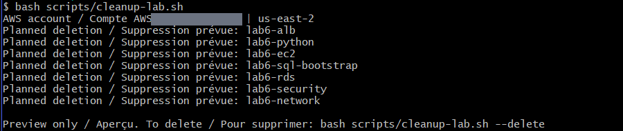
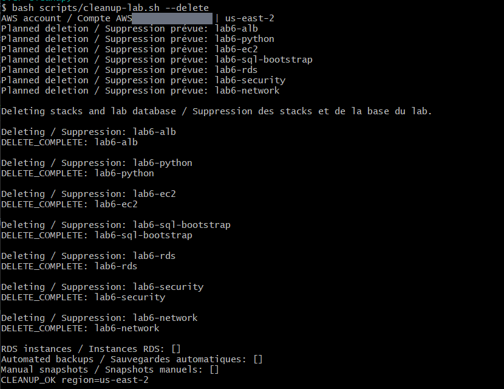
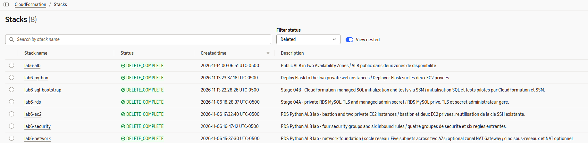

# Étape 07 — Basculement, preuves et nettoyage

**Français** | [English](en/07-failover-cleanup.md)

## Simuler une panne du chemin ALB → WebA

Depuis la branche `ops/07-failover-cleanup` :

```bash
bash scripts/test-alb-failover.sh
```

Le script vérifie d’abord que les deux cibles répondent. Il met ensuite à jour `lab6-alb` via CloudFormation pour enregistrer WebA sur le port 8081 au lieu de 8080. Flask continue d’écouter sur 8080 et le groupe de sécurité Web autorise l’ALB sur 8080. WebA devient donc inaccessible à l’ALB, même si le processus Flask tourne toujours. WebB garde son port 8080.

| Moment | WebA | WebB | Ce qu’on observe |
|---|---|---|---|
| Avant | 8080, `healthy` | 8080, `healthy` | Les deux instances répondent. |
| Pendant | 8081, `unhealthy` | 8080, `healthy` | Après détection, les 10 requêtes vont à WebB. |
| Après | 8080, `healthy` | 8080, `healthy` | Les deux répondent de nouveau. Le script affiche `FAILOVER_OK`. |

Un échec transitoire reste possible pendant la propagation ou la détection. Le test mesure les requêtes après le changement d’état. Il démontre la continuité avec une cible web saine. RDS reste une instance Single-AZ.

Si le terminal se ferme pendant le test ou si la session AWS expire, rétablis la configuration normale depuis Git Bash.

```bash
bash scripts/deploy-alb.sh
bash scripts/check-alb.sh
```

Pour le portfolio, note les deux zones, les états des cibles, le nombre de réponses WebB pendant la panne et le résultat après rétablissement. Si tu partages une capture, masque les identifiants de compte et l’URL temporaire. Tu peux conserver tes sorties brutes dans `local/`, que Git ignore.

## Nettoyer les ressources AWS

Quand tu as fini de tester et pris tes notes, affiche d’abord les stacks ciblées dans le compte courant, région `us-east-2`.

```bash
bash scripts/cleanup-lab.sh
```

La commande suivante lance la suppression. Elle efface les données de `lab6-mysql` sans créer de snapshot final et attend la fin de chaque stack. La clé SSH existante `1st-web-server` est réutilisée par le lab et reste disponible.

```bash
bash scripts/cleanup-lab.sh --delete
```

Ordre de suppression des stacks :

1. `lab6-alb` et `lab6-python` pour retirer l’entrée publique et les associations d’installation.
2. `lab6-ec2` pour retirer les instances et leurs volumes de lab. `lab6-sql-bootstrap` supprime ensuite ses profils IAM, associations et secret applicatif.
3. `lab6-rds` pour retirer l’instance MySQL et ses sauvegardes automatiques.
4. `lab6-security`, puis `lab6-network` pour retirer les groupes de sécurité, le NAT, l’Elastic IP et le VPC.

Le script affiche `CLEANUP_OK` une fois les stacks traitées et après avoir vérifié l’absence d’instance, de sauvegarde automatique et de snapshot manuel pour `lab6-mysql`. Un snapshot manuel préexistant sera signalé pour que tu puisses décider de son sort. Si une stack échoue, le script s’arrête et affiche les événements d’échec de suppression disponibles. Une fois le blocage réglé, relance la même commande.

## Résultats observés

WebB a servi les 10 requêtes mesurées en HTTP 200 après la perte de WebA. Les deux cibles sont redevenues saines sur le port 8080. Le script de nettoyage a confirmé la suppression des sept stacks et l’absence de la base du lab, de sauvegardes automatiques et de snapshots manuels. L’application lisait toujours 13 étudiants dans RDS via TLS pendant le basculement.



*Aperçu des sept stacks ciblées avant suppression dans us-east-2.*



*Git Bash affiche CLEANUP_OK et des listes RDS vides.*



*Les sept stacks du lab affichent DELETE_COMPLETE dans CloudFormation.*

## GitHub

Publie la branche et ouvre une PR dont la base est `develop`. Ajoute les résultats avant, pendant et après le test, puis le résultat du nettoyage si tu l’as exécuté.
