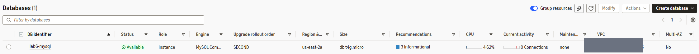

# Stage 04 — Understand and deploy RDS MySQL

[Français](../04-rds.md) | [Home](../../README.md)

## Two parts for understanding and verification

- **04A, now:** create private RDS, the empty `labapp` schema, subnet group, TLS parameters and administrator secret.
- **04B, after 04A is verified:** automate SQL initialization, tables and a least-privilege application account, then test a TLS connection with server verification.

This guide covers **04A**. Continue with [04B: automated SQL initialization](04b-sql-bootstrap.md). The complete stage 04 will only be validated after 04B. The 04-rds.yaml template does not create an application account or business tables.

## 1. What changes from the first lab

In the first lab, MariaDB ran on an EC2 instance you administered. Here, **MySQL runs in RDS**: AWS manages the service infrastructure, backup mechanisms and scheduled maintenance, among other tasks. You define the engine, size, network, SQL accounts and data retention.

Your EC2 instances remain the application servers. They will send SQL queries to RDS on TCP 3306. The bastion will support initialization and troubleshooting. RDS is not administered through SSH.

Two controls work together:
1. the **security group** allows network traffic from the web or bastion group;
2. **MySQL** authenticates the account and checks its SQL privileges.

Network access alone therefore does not grant table access.

## 2. Read the template before running it

Open `cloudformation/04-rds.yaml`. It declares three CloudFormation resources:

| Resource | Concrete purpose |
|---|---|
| `DbSubnetGroup` | References the two existing private subnets; defines eligible RDS placement |
| `DbParameterGroup` | Configures MySQL 8.4 to require encrypted connections |
| `Database` | Creates RDS, its storage and the empty `labapp` schema |

RDS also creates the administrator secret in Secrets Manager through `ManageMasterUserPassword`. RDS manages this secret; it is not declared as a fourth template resource.

| Property | Lab value | Reason |
|---|---|---|
| `Engine` / `EngineVersion` | MySQL / 8.4 version checked in Ohio | Use the guide's engine with an actually available version |
| `DBInstanceClass` | `db.t4g.micro` | Small capacity for this temporary lab |
| `DBName` | `labapp` | Create the initial schema; tables follow in 04B |
| `DBSubnetGroupName` | Group of both private subnets | Define eligible network placement |
| `AvailabilityZone` / `MultiAZ` | AZ A / `false` | One DB instance without a Multi-AZ standby |
| `PubliclyAccessible` | `false` | Private connectivity inside the VPC |
| `VPCSecurityGroups` | RDS group from stage 02 | Allow 3306 from web and bastion groups |
| `AllocatedStorage` / `StorageType` | 20 GiB / gp3 | SSD capacity allocated to the database |
| `StorageEncrypted` | `true` | Encrypt data at rest |
| `require_secure_transport` | `1` | Require encrypted SQL connections |
| `MasterUsername` | `admin` | Administration account for initialization |
| `ManageMasterUserPassword` | `true` | RDS generates and stores the password in Secrets Manager |
| `BackupRetentionPeriod` | 1 day | Short automated backup retention |
| `AutoMinorVersionUpgrade` | `true` | Allow RDS-scheduled automatic minor updates |
| `DeletionPolicy` / `UpdateReplacePolicy` | `Delete` | Remove temporary data on deletion/replacement |

**Two subnets in two AZs do not mean two databases.** The subnet group supplies eligible placement; `MultiAZ: false` creates one instance, placed in AZ A here. RDS normally requires two-AZ coverage in the subnet group even for Single-AZ.

Storage encryption and TLS protect different things: data at rest and data in transit. Clients in 04B will also verify the certificate and server hostname.

## Understand the CloudFormation code structure

- **`Parameters`**: values needed for deployment. The script fills them from network/security outputs and available RDS options; no IDs need to be copied.
- **`Resources`**: the desired state of the three AWS resources managed by this stack.
- **`Outputs`**: generated information the next stage will reuse, such as the endpoint.
- **`!Ref DbSubnetGroup`**: reuses the name of the subnet group created in this template. This reference also expresses a creation dependency.
- **`!GetAtt Database.Endpoint.Address`**: reads the DNS address AWS provides for the RDS instance.

The **RDS instance** is the managed MySQL server. **`labapp`** is a logical database inside it. Its **tables** will be created in 04B. These are three different levels.

The Bash script prepares inputs, calls CloudFormation and reads results. CloudFormation provisions resources; the current script executes no SQL commands.

## 3. Password, endpoint and responsibilities

RDS generates the administrator password. The script neither displays nor retrieves its value. **`MasterSecretArn` identifies the secret**; IAM permissions will control retrieval during automated initialization.

The future application account will receive only the SQL privileges it needs. The application will use that account. The `admin` account remains for administration.

**`DbEndpoint` is a MySQL server DNS name**. The SQL client will use this name and port 3306; it is not an HTTP URL. NAT is not used for private EC2 → RDS connections inside the VPC.

## 4. Branch and deployment

After merging stage 03:

```bash
git switch develop
git pull --ff-only origin develop
git switch -c infra/04-rds
```

Extract the patch at the repository root, preserving paths. Review personal additions before replacing README files.

```bash
bash scripts/deploy-rds.sh
```

The script:
1. checks `lab6-network` and `lab6-security`, their shared VPC and the two private AZs;
2. asks AWS for available MySQL 8.4 options matching the class, AZ A, gp3, encryption and 20 GiB;
3. selects the newest compatible patch on first creation using numeric version sorting;
4. retains the stack's requested version and class on reruns unless explicitly changed;
5. validates and deploys `lab6-rds`, displays configuration and verifies the TLS parameter value;
6. keeps outputs in Git-ignored `local/rds-outputs.json`.

Option checks do not guarantee account quotas, permissions or credits. If AWS does not offer the requested class, the script stops. After review, an alternative micro class can be explicitly requested:

```bash
LAB_DB_CLASS=db.t3.micro bash scripts/deploy-rds.sh
```

`LAB_MYSQL_VERSION` can request a specific patch; it must pass the same compatibility checks. Do not change it on an existing database without reviewing the impact. RDS automatic minor updates may also change the effective version over the service lifetime.

RDS creation can take several minutes. Let deployment finish.

## 5. Read and verify the result

Expected:
- stack **`CREATE_COMPLETE`**, DB instance **`available`**;
- MySQL 8.4, micro class, `labapp` schema;
- `Public: False`, `MultiAZ: False`, `Encrypted: True`, 20 GiB gp3 storage;
- the same VPC as other resources and AZ A;
- port 3306, endpoint present, administrator secret `active`;
- `require_secure_transport=1`.

RDS/storage and the secret incur charges in addition to existing resources. Free usage is not inferred from the account type. RDS micro instances can also incur CPU surplus credit charges depending on usage.

To check the three CloudFormation resources:

```bash
aws cloudformation list-stack-resources \
  --stack-name lab6-rds \
  --query 'StackResourceSummaries[].[LogicalResourceId,ResourceType,ResourceStatus]' \
  --output table --region us-east-2 --no-cli-pager
```

An `available` status does not prove SQL connectivity from the bastion or application: that will be tested in 04B.

On failure:

```bash
aws cloudformation describe-stack-events \
  --stack-name lab6-rds \
  --query 'StackEvents[?ResourceStatus==`CREATE_FAILED` || ResourceStatus==`UPDATE_FAILED`].[LogicalResourceId,ResourceStatusReason]' \
  --output table --region us-east-2 --no-cli-pager
```

Read the exact cause before retrying. Investigate and delete a `ROLLBACK_COMPLETE` stack before recreating it. Do not delete a database containing data you want to keep.

## Observed 04A result

On November 6, 2026, AWS CLI confirmed: instance `available`, MySQL `8.4.13`, database `labapp`, port 3306, encrypted storage, public access disabled and Single-AZ. SQL tests remain for 04B.



*The lab6-mysql MySQL instance is available in us-east-2a. The Multi-AZ column shows No.*

## 6. Git and the remainder of this stage

Stay on `infra/04-rds` for 04A and 04B. After verifying this first part, an intermediate commit is possible:

```bash
git add README.md README.fr.md cloudformation/04-rds.yaml scripts/deploy-rds.sh docs/04-rds.md docs/en/04-rds.md
git diff --cached --check
git diff --cached --stat
git commit -m "infra: add private RDS MySQL with managed admin secret"
git push -u origin infra/04-rds
```

Record actual results in both README files and the guide. Keep stage 04 marked as in progress until SQL initialization and tests pass. The complete PR into `develop` can then cover the whole stage.

## 7. Delete at the end of the lab

This lab chooses complete deletion of temporary data: `DeletionProtection: false`, `DeletionPolicy: Delete`, `UpdateReplacePolicy: Delete` and `DeleteAutomatedBackups: true`. Deletion produces no final snapshot and removes automated backups. RDS also deletes its managed administrator secret. Check separately for manually created snapshots or copies.

After removing future resources that depend on this database:

```bash
aws cloudformation delete-stack --stack-name lab6-rds --region us-east-2
aws cloudformation wait stack-delete-complete --stack-name lab6-rds --region us-east-2
```

These commands are for final cleanup, not deployment. Other lab resources, including EC2 and NAT, remain until their stacks are deleted.

## Sources

- [CloudFormation — DBInstance](https://docs.aws.amazon.com/AWSCloudFormation/latest/TemplateReference/aws-resource-rds-dbinstance.html)
- [AWS — RDS in a VPC](https://docs.aws.amazon.com/AmazonRDS/latest/UserGuide/USER_VPC.WorkingWithRDSInstanceinaVPC.html)
- [AWS — RDS-managed administrator password](https://docs.aws.amazon.com/AmazonRDS/latest/UserGuide/rds-secrets-manager.html)
- [AWS — require MySQL TLS](https://docs.aws.amazon.com/AmazonRDS/latest/UserGuide/mysql-ssl-connections.require-ssl.html)
- [AWS — orderable RDS options](https://docs.aws.amazon.com/cli/latest/reference/rds/describe-orderable-db-instance-options.html)
- [RDS MySQL pricing](https://aws.amazon.com/rds/mysql/pricing/)
